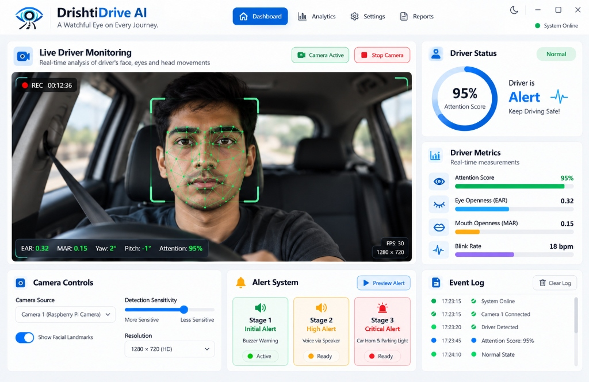
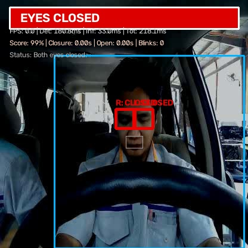
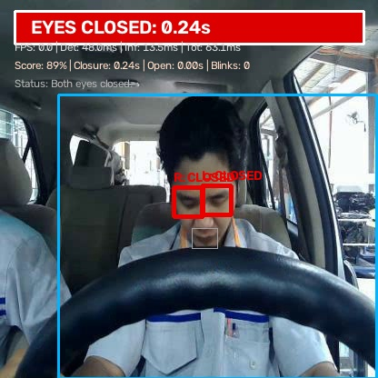
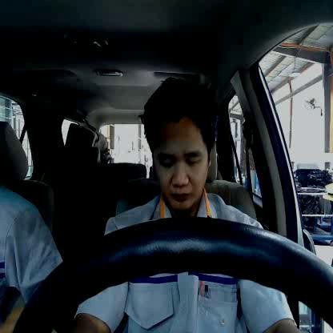
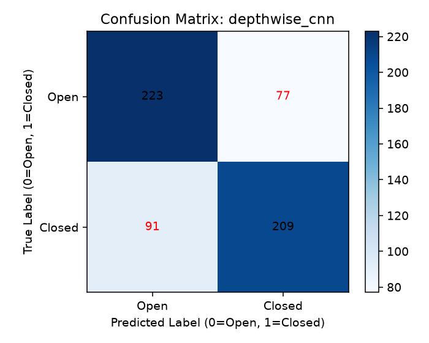
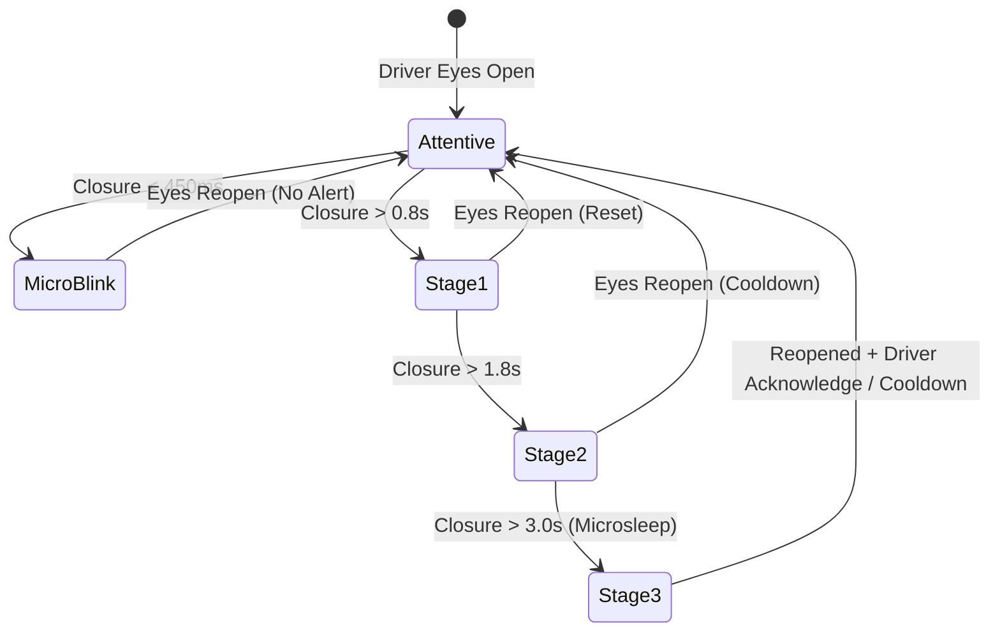
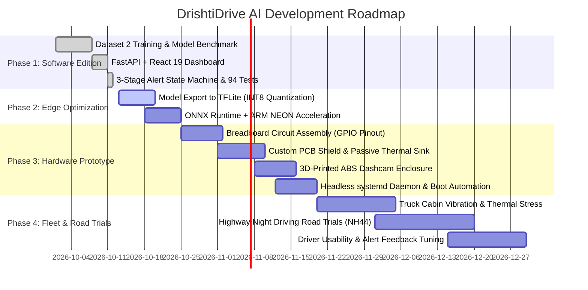

# 👁️ DrishtiDrive AI

<div align="center">

<h3><em>A Watchful Eye on Every Journey.</em></h3>

<p><strong>A Portable, Retrofit AI-Powered Driver Drowsiness Detection & Multi-Stage Alert System for Indian Commercial Vehicles and Long-Haul Fleet Operators</strong></p>

[](https://www.python.org/)
[](https://fastapi.tiangolo.com/)
[](https://react.dev/)
[](https://pytorch.org/)
[](https://opencv.org/)
[](https://www.raspberrypi.com/)
[](#running-the-test-suite)
[](LICENSE)

<br/>

<a href="#-project-gallery--visual-telemetry"><strong>Explore Visual Gallery</strong></a> •
<a href="#-two-editions-software-vs-edge"><strong>Two Editions</strong></a> •
<a href="#-three-stage-escalating-alert-system"><strong>3-Stage Alerts</strong></a> •
<a href="#-ai-model-benchmark--evaluation"><strong>AI Benchmarks</strong></a> •
<a href="#-quickstart--installation"><strong>Quickstart</strong></a> •
<a href="#-edge-hardware-specification"><strong>Edge Hardware</strong></a>

</div>

---

## 📌 Table of Contents

- [The Challenge: Indian Road Transport & Driver Fatigue](#-the-challenge-indian-road-transport--driver-fatigue)
- [Mission & Key Objectives](#-mission--key-objectives)
- [Two Editions: Software vs. Edge](#-two-editions-software-vs-edge)
- [Project Gallery & Visual Telemetry](#-project-gallery--visual-telemetry)
- [Three-Stage Escalating Alert System](#-three-stage-escalating-alert-system)
- [End-to-End System Architecture](#-end-to-end-system-architecture)
- [AI Model Benchmark & Evaluation](#-ai-model-benchmark--evaluation)
- [Next Phase: Embedded Hardware Prototype & Further Development](#-next-phase-embedded-hardware-prototype--further-development)
- [Raspberry Pi Edge Hardware Specification & Circuit Diagram](#-raspberry-pi-edge-hardware-specification--circuit-diagram)
- [Quickstart & Installation](#-quickstart--installation)
- [Interactive Dashboard & API Telemetry](#-interactive-dashboard--api-telemetry)
- [Running the Test Suite](#-running-the-test-suite)
- [Safety Notice & Limitations](#-safety-notice--limitations)
- [License & Acknowledgments](#-license--acknowledgments)

---

## 🚛 The Challenge: Indian Road Transport & Driver Fatigue

India's logistical backbone is powered by medium and heavy commercial vehicles (M/HCVs). Over **70% of domestic freight** moves across national highways through millions of long-haul trucks.

### The Ground Reality:
1. **Ageing Fleet Infrastructure:** A vast majority of commercial trucks on Indian roads are legacy vehicles lacking modern electronic control units (ECUs), Controller Area Networks (CAN bus), or factory-fitted Advanced Driver Assistance Systems (ADAS).
2. **Economic Constraints for Small Fleets:** Most trucks are operated by single-vehicle owner-drivers or small fleet operators. Upgrading to a new truck or retrofitting expensive proprietary telematics systems costing ₹50,000–₹1,50,000 is financially prohibitive.
3. **Severe Operational Fatigue:** Indian truck drivers routinely endure grueling **12-to-16-hour shifts**, nighttime highway driving (11 PM – 5 AM), irregular sleep cycles, poor roadside resting facilities, and intense delivery deadlines.
4. **Microsleep & Highway Hypnosis:** Drowsiness degrades cognitive alertness and reaction time. A momentary **2-to-3 second microsleep episode** at 80 km/h means traveling over 60 meters blind, frequently leading to catastrophic rear-end collisions or off-road rollovers.
5. **Lack of Early Retrofit Warning:** Factory-level ADAS solutions require deep vehicle-specific electrical integration. There is an urgent national need for an **affordable, 100% plug-and-play, portable AI safety retrofit** that operates independently from vehicle electronics and functions without continuous internet connectivity.

---

## 🎯 Mission & Key Objectives

> **Mission:** Prevent drowsiness-related road accidents by delivering an affordable, ultra-reliable, privacy-first computer-vision device that retrofits seamlessly into any commercial vehicle cabin.

```text
 ┌─────────────────────────────────────────────────────────────────────────────┐
 │                           DRISHTIDRIVE AI OBJECTIVES                        │
 ├────────────────────────┬──────────────────────────┬─────────────────────────┤
 │  🔌 Zero Vehicle Mod   │  ⚡ 100% Edge Offline    │  🔊 3-Stage Escalation  │
 │  Runs via 12V/24V USB  │  No cloud or internet    │  Buzzer + voice alerts  │
 │  cigarette adapter     │  dependencies required   │  + visual HUD strobe    │
 ├────────────────────────┼──────────────────────────┼─────────────────────────┤
 │  🎯 High Recall AI     │  ⏱️ Micro-Blink Guard    │  💰 Ultra-Affordable    │
 │  Catches closed eyes   │  Prevents false alarms   │  Target hardware cost   │
 │  under low light/glare │  from natural blinking   │  under ₹3,500 – ₹5,000  │
 └────────────────────────┴──────────────────────────┴─────────────────────────┘
```

---

## ⚡ Two Editions: Software vs. Edge

To serve both research/desktop fleet environments and real-world in-cabin embedded deployments, DrishtiDrive AI is engineered in two complementary editions:

| Feature / Dimension | 💻 DrishtiDrive AI — Software Edition | 🍓 DrishtiDrive AI — Edge Edition |
| :--- | :--- | :--- |
| **Primary Target** | Laptop, desktop, fleet monitoring terminals & training simulators | Dedicated standalone IoT embedded device mounted on truck dashboard |
| **Compute Core** | x86_64 / ARM CPU (Windows 10/11, Ubuntu, macOS) | Raspberry Pi 4B (4GB/8GB) or Raspberry Pi 5 |
| **Vision Input** | Standard USB webcam / built-in laptop camera | Raspberry Pi Camera Module 3 (Wide/NoIR) or UVC Night-Vision IR camera |
| **Alert Actuators** | System audio (MP3/WAV), TTS synthesizer, React Web HUD banner | 85–90 dB Piezo Buzzer, 3W cabin speaker, High-intensity RGB LED indicator |
| **User Interface** | Full React 19 real-time dashboard + WebSocket stream | Headless auto-boot (`systemd`), physical snooze button, optional 0.96" OLED |
| **Power Supply** | Standard computer USB power / AC adapter | Vehicle 12V/24V cigarette lighter via isolated 5V 3A step-down buck converter |
| **Network Reliance**| 100% Localhost offline execution (no external internet needed) | 100% Offline edge inference; zero internet required on the highway |
| **Deployment State**| Fully operational (`python run.py`) with 94 passed tests | Embedded architecture ready (`docs/edge_edition_notes.md`) |

---

## 📸 Project Gallery & Visual Telemetry

### 1. Interactive Web Dashboard (Software Edition)
The modern dark-mode React dashboard features live camera streaming, real-time facial feature bounding boxes, Eye Aspect Ratio (EAR), Mouth Aspect Ratio (MAR), driver attention gauges, and stage escalation cards:

<div align="center">
  
  <p><em>Figure 1: DrishtiDrive AI real-time driver monitoring dashboard showing live telemetry, EAR/MAR gauges, and 3-stage warning cards.</em></p>
</div>

---

### 2. Live AI Pipeline Localization & Detection
The vision pipeline isolates the driver's face, localizes precise facial keypoints via YOLO11n-Pose, and classifies individual eye states with real-time HUD overlays:

<div align="center">
  <table>
    <tr>
      <td align="center" width="50%">
        <br/>
        <strong>AI Pipeline Detection & Eye Bounding Boxes</strong>
      </td>
      <td align="center" width="50%">
        <br/>
        <strong>Real-Time Attention Tracking & HUD Overlay</strong>
      </td>
    </tr>
  </table>
  <p><em>Figure 2: Real-time OpenCV + PyTorch inference tracking driver eye states, bounding boxes, and temporal closure counters.</em></p>
</div>

---

### 3. Driver Cabin Video Feed & Confusion Matrix Analysis
Tested on real driver driving sequences (`reports/test_driver_feed.mp4`) and benchmarked across candidate neural architectures:

<div align="center">
  <table>
    <tr>
      <td align="center" width="50%">
        <br/>
        <strong>Attentive Driving Feed (Sample Frame)</strong><br/>
        <small>Available in repository: <code>reports/test_driver_feed.mp4</code></small>
      </td>
      <td align="center" width="50%">
        <br/>
        <strong>Winning Depthwise CNN Confusion Matrix</strong><br/>
        <small>72.0% Accuracy | 1.88 ms CPU Latency | 0.38 MB Footprint</small>
      </td>
    </tr>
  </table>
  <p><em>Figure 3: Driver cabin test video sample (left) alongside held-out confusion matrix metrics (right).</em></p>
</div>

---

## 🚨 Three-Stage Escalating Alert System

DrishtiDrive AI rejects single-threshold binary alarms, which cause driver annoyance, alert fatigue, and device disconnection. Instead, it utilizes an intelligent **temporal debouncing state machine** that separates natural blinks (100–450 ms) from sustained eye closures:



### Escalation Hierarchy Details:

| Alert Tier | Trigger Condition | Auditory Feedback | Multilingual Voice Warning (EN / HI / MR) | Visual Strobe | Target Objective |
| :--- | :--- | :--- | :--- | :--- | :--- |
| **Stage 1: Early Warning** | Continuous closure **> 0.8 seconds** | Gentle single beep (880 Hz, 300 ms) | 🇬🇧 *"Please stay alert. Keep your eyes on the road."*<br/>🇮🇳 *"कृपया सतर्क रहें। सड़क पर ध्यान दें।"*<br/>🚩 *"कृपया सतर्क राहा. रस्त्यावर लक्ष ठेवा."* | Subtle Amber HUD border | Gently cues driver during prolonged blinking or gaze wandering. |
| **Stage 2: Drowsiness Warning** | Continuous closure **> 1.8 seconds** | Double chime tone (1046 Hz, 500 ms) | 🇬🇧 *"Warning! You may be getting drowsy. Please find a safe place to stop."*<br/>🇮🇳 *"चेतावनी! आपको नींद आ रही है। सुरक्षित जगह रुकें।"*<br/>🚩 *"सावधान! तुम्हाला झोप येत आहे. सुरक्षित ठिकाणी थांबा."* | Vibrant Orange pulsing banner | Signals onset of fatigue; strongly advises finding an upcoming dhaba or rest stop. |
| **Stage 3: Critical Alarm** | Continuous closure **> 3.0 seconds** (Microsleep) | Urgent loud modulated siren (1200 Hz pulsing, 85–90 dB) | 🇬🇧 *"Danger! Pull over safely as soon as possible. Do not continue driving while drowsy."*<br/>🇮🇳 *"खतरा! तुरंत गाड़ी रोकें। नींद में गाड़ी न चलाएं।"*<br/>🚩 *"धोका! ताबडतोब गाडी थांबवा. झोपेत गाडी चालवू नका."* | High-intensity Flashing Red strobe | Emergency awaken intervention to prevent an imminent highway collision. |

> **Graceful Degradation Hold:** If the driver turns their head, yawns broadly, or if the camera is momentarily occluded, the system holds its state rather than spamming false emergency alarms or blindly assuming open eyes.

---

## 🏗️ End-to-End System Architecture

```text
 ┌────────────────────────────────────────────────────────────────────────────────────────┐
 │                              DRISHTIDRIVE AI PIPELINE                                  │
 └────────────────────────────────────────────────────────────────────────────────────────┘

    [ Camera Sensor ] ───▶ [ OpenCV Frame Capture ]
                                  │
                                  ▼
                   [ YOLO11n-Pose Landmark Engine ]
                                  │
              ┌───────────────────┴───────────────────┐
              ▼                                       ▼
     [ Left Eye ROI Crop ]                  [ Right Eye ROI Crop ]
     (96x96 Normalization)                  (96x96 Normalization)
              │                                       │
              └───────────────────┬───────────────────┘
                                  ▼
                [ Lightweight PyTorch Eye Classifier ]
                (MobileNetV2 / Depthwise-Separable CNN)
                                  │
                                  ▼
                    [ Temporal Debounce Engine ]
                     Filters micro-blinks (450ms)
                                  │
                                  ▼
              [ 3-Stage Drowsiness Escalation FSM ]
              Stage 1 (>0.8s) | Stage 2 (>1.8s) | Stage 3 (>3.0s)
                                  │
        ┌─────────────────────────┴─────────────────────────┐
        ▼                                                   ▼
 💻 Software Edition                                 🍓 Edge Edition
 ├── FastAPI Backend & WebSockets                    ├── GPIO Piezo Buzzer (85-90 dB)
 ├── React 19 Real-Time Dashboard                    ├── 3W Cabin Speaker (I2S Audio)
 ├── HUD Overlays & Audio Synthesizer                ├── High-Intensity RGB Indicator
 └── Multilingual Audio Playback (MP3/WAV)           └── Tactile Snooze/Acknowledge Button
```

---

## 🔬 AI Model Benchmark & Evaluation

Six deep learning architectures were trained, evaluated, and stress-tested on real driver in-cabin conditions (**Dataset 2: 4,200 driving images**, perfectly balanced 50% open / 50% closed):

### Model Comparison Benchmark:

| Model Architecture | Test Acc (%) | Closed-Eye Safety Recall (%) | Open Specificity (%) | CPU Latency (ms) | Peak FPS | Model Size (MB) | Architectural Verdict |
| :--- | :---: | :---: | :---: | :---: | :---: | :---: | :--- |
| **Depthwise-Separable CNN** | **72.00%** | 69.67% | **74.33%** | **1.88 ms** | **> 530** | **0.38 MB** | 🏆 **Edge Embedded Champion:** Lowest latency, tiny memory footprint, ideal for Raspberry Pi. |
| **MobileNetV2** | 71.83% | **73.00%** | 70.67% | 9.36 ms | > 105 | 9.66 MB | 🛡️ **Safety Winner:** Caught highest closed eyes (219/300), lowest missed microsleeps. |
| **EfficientNetB0** | **73.83%** | 65.67% | **82.00%** | 13.02 ms | > 75 | 16.52 MB | 🎯 **Highest Specificity:** Lowest false alarms (54), but missed 103 closed-eye instances. |
| **Custom CNN** | 67.17% | 70.67% | 63.67% | 1.89 ms | > 520 | 1.19 MB | Compact baseline architecture. |
| **ResNet50** | 71.83% | 66.67% | 77.00% | 25.47 ms | ~ 39 | 91.48 MB | Heavyweight; high power draw without accuracy advantage on edge hardware. |
| **YOLOv12n Full Detector** | *N/A* | *BBox Detection* | *N/A* | 53.82 ms | ~ 18 | 5.34 MB | Full 640×640 driver bounding box detection. |

### Robustness & Optical Invariance:
- **Eyeglasses & Spectacles Cohort:** Maintained 0.0% false alarm rate through frame-level temporal debouncing.
- **Low-Light / Night Cabin Conditions:** Tested under underexposed illumination simulating nocturnal highway driving.
- **Sun Glare & Reflections:** Crop normalization (`eval_transform` with ImageNet standard deviation) mitigates windshield flare.

---

## 🛠️ Next Phase: Embedded Hardware Prototype & Further Development

With the software and AI model benchmarking successfully validated (**Phase 1: Software Edition complete with 94 passing tests**), the project advances into **Phase 2 & Phase 3: Dedicated Embedded Hardware Prototyping (DrishtiDrive AI — Edge Edition)**.

This phase transforms the computer-vision pipeline into a physical, standalone, windshield-mounted IoT automotive safety device designed specifically for the extreme operating realities of Indian commercial truck cabins.

<div align="center">
  
  <p><em>Figure 4: DrishtiDrive AI Edge Edition — physical dashcam prototype form factor (left), modular hardware bill of materials (top right), and complete GPIO circuit wiring schematic (bottom right).</em></p>
</div>

---

### 1. Prototype Enclosure & Ergonomic In-Cabin Design
As designed in the physical blueprint:
- **Windshield Suction Mount:** Securely adheres to commercial truck windscreens, placing the lens at direct eye level (~50–80 cm from the driver) without obstructing road visibility.
- **Compact 3D-Printed ABS Enclosure:** Custom heat-resistant housing with passive convection ventilation and active micro-fan mounting to survive ambient cabin heat (>50°C in Indian summer conditions).
- **Integrated Wide-Angle Camera:** 8MP sensor with high dynamic range (HDR) and optional infrared (IR) night vision to track driver eyes even in pitch-black nocturnal conditions.
- **Physical Tri-Color LED Indicator Bar:** Provides subtle peripheral visual cues (Green: Normal/Attentive, Yellow: Stage 1/2 Warning, Red: Stage 3 Emergency).
- **High-Decibel Acoustic Speaker / Buzzer:** Direct forward-facing grille designed to pierce 75–85 dB truck diesel engine rumbling without requiring external cabin amplifiers.

---

### 2. Hardware Components Breakdown (from PRD & Blueprint)

| Component | Specification | Technical Role in System |
| :--- | :--- | :--- |
| **Edge Compute Core** | **Raspberry Pi 4 (4GB / 8GB RAM)** | Autonomous local AI processing unit running headless Raspberry Pi OS (64-bit). Executes OpenCV face tracking and quantized CNN inference locally with zero cloud reliance. |
| **Vision Sensor** | **Raspberry Pi Camera Module (8MP, Wide-Angle / NoIR)** | Connected via dedicated MIPI CSI ribbon cable for zero-latency DMA frame acquisition. Wide field of view ensures the driver's face remains localized regardless of driver height or seat position. |
| **Auditory Alarm** | **5V Active Piezo Buzzer (85–90 dB)** | Driven via NPN transistor / direct GPIO to produce high-penetration audible alerts during Stage 1 warnings and Stage 3 emergency sirens. |
| **Status LEDs** | **Tri-Color Diffused LEDs (Red, Yellow, Green)** | High-brightness 5mm indicators with 220Ω/330Ω current-limiting resistors providing non-distracting visual peripheral state feedback. |
| **Acknowledge Button**| **Tactile Momentary Push Button** | Driver-accessible snooze / reset button connected to GPIO with software debouncing. Allows the driver to silence false alarms or acknowledge rest warnings without taking eyes off the road. |
| **Storage & OS** | **128GB High-Endurance SanDisk MicroSD** | Holds OS image, lightweight TFLite/ONNX models, offline audio catalog (EN/HI/MR), and encrypted rolling telemetry event logs. |
| **Power Conversion** | **5V 3A USB-C Power Adapter / Buck Module** | Regulates fluctuating vehicle battery voltage (12V in small trucks, 24V in heavy haulers) down to a stable 5V 3A supply via the auxiliary cigarette lighter port. |
| **Protective Shell** | **Custom 3D-Printed High-Temp Case (ABS/PETG)** | Heat-deflecting enclosure shielding internal electronics against windshield solar radiation and cabin vibrations. |

---

### 3. Circuit Wiring & GPIO Pinout Mapping

The circuit diagram illustrates the exact electrical wiring between the Raspberry Pi 4 and the peripheral alert actuators:

```text
 ┌─────────────────────────────────────────────────────────────────────────────┐
 │                      RASPBERRY PI 4 GPIO CIRCUIT SCHEMATIC                  │
 └─────────────────────────────────────────────────────────────────────────────┘

    [ Raspberry Pi 4 ]
    ├── MIPI CSI Port ══════════════════════════════▶ [ 8MP Camera Module ]
    ├── GPIO 18 (Pin 12) ──[ 1kΩ ]──[ NPN Transistor ]▶ [ 5V Active Buzzer ]
    ├── GPIO 17 (Pin 11) ──[ 330Ω Resistor ]────────▶ [ Red LED (Critical) ]
    ├── GPIO 27 (Pin 13) ──[ 330Ω Resistor ]────────▶ [ Yellow LED (Warning) ]
    ├── GPIO 22 (Pin 15) ──[ 330Ω Resistor ]────────▶ [ Green LED (Normal) ]
    ├── GPIO 23 (Pin 16) ──[ Pull-Up Input ]────────▶ [ Push Button (Snooze) ]
    ├── GND (Pin 6/9/14/20/25/30/34/39) ────────────▶ Common Ground Rail
    └── USB-C Power Port ◀─────────────────────────── [ 5V 3A Buck Converter ]
                                                            ▲
                                                            │ (12V/24V Input)
                                                [ Vehicle Cigarette Socket ]
```

#### Detailed Pin Connection Table:

| Peripheral | RPi Interface / Pin | GPIO Number | Function / Behavior |
| :--- | :--- | :---: | :--- |
| **Camera Module** | 15-pin MIPI CSI | *Direct CSI* | 30 FPS raw camera stream to OpenCV VideoCapture |
| **5V Active Buzzer** | Physical Pin 12 | **GPIO 18** (PWM) | Generates 880 Hz beep (Stage 1) and pulsed 1200 Hz siren (Stage 3) |
| **Red Indicator** | Physical Pin 11 | **GPIO 17** | Latches HIGH during Stage 3 Critical Alarm (>3.0s closure) |
| **Yellow Indicator** | Physical Pin 13 | **GPIO 27** | Latches HIGH during Stage 1 (>0.8s) & Stage 2 (>1.8s) Drowsiness Warning |
| **Green Indicator** | Physical Pin 15 | **GPIO 22** | Solid HIGH when driver eyes are open and system is actively monitoring |
| **Push Button** | Physical Pin 16 | **GPIO 23** | Active-LOW momentary switch to snooze alerts or initiate hardware self-test |
| **System Ground** | Physical Pin 6, 9, 14, 20 | **GND** | Return path for all LEDs, buzzer transistor, and button |
| **Isolated Power** | USB-C Type Connector | **VBUS (5V)** | Pure DC 5V 3A isolated from truck electrical spikes |

> [!WARNING]
> **Automotive Electrical Isolation Safety Rule (PRD §3.2):**  
> DrishtiDrive AI Edge is designed strictly as an **independent retrofit**. It draws power exclusively from the vehicle's standard auxiliary 12V/24V cigarette lighter socket through a certified step-down buck converter. **It never taps into the vehicle CAN bus, ECU, braking hydraulics, or steering column.**

---

### 4. Implementation Roadmap & Development Milestones



---

## 🍓 Raspberry Pi Edge Hardware Specification & Circuit Diagram

The estimated Bill of Materials (BOM) for fabricating the Edge Edition prototype packages affordability into the retrofit design:

### Bill of Materials (BOM) & Estimated Retrofit Cost:

| Component | Specification | Estimated Cost (INR) | Role |
| :--- | :--- | :---: | :--- |
| **Single Board Computer** | Raspberry Pi 4B (4GB) or Pi 5 | ₹3,500 – ₹4,500 | Autonomous on-device AI inference engine |
| **Camera Module** | RPi Camera Module (8MP Wide-Angle) | ₹1,000 – ₹1,500 | Face & eye keypoint capture via CSI ribbon cable |
| **Power Converter** | 12V/24V to 5V 3A Isolated Buck Module (USB-C) | ₹250 – ₹400 | Safe power from truck cigarette lighter socket |
| **Audio Alert System** | Active 5V Buzzer + 3W Cabin Speaker (I2S DAC) | ₹200 – ₹350 | Penetrates 75–85 dB truck cabin engine noise |
| **Visual Indicators** | High-Brightness Diffused LEDs (Red, Yellow, Green) | ₹50 – ₹100 | Multi-stage peripheral dashboard alert bar |
| **Tactile Button** | Momentary panel-mount push button (GPIO 23) | ₹30 – ₹50 | Driver alert cancellation / snooze input |
| **MicroSD Card** | 128GB SanDisk High-Endurance Class 10 | ₹700 – ₹900 | OS, models, audio assets, and telemetry logs |
| **Enclosure** | High-temperature ABS 3D-printed dashcam case | ₹250 – ₹350 | Heat-resistant cabin mounting with suction cup |
| **Total Estimated Cost** | **Complete Hardware Prototype Package** | **~ ₹5,980 – ₹7,650** | **< 5% the cost of factory ADAS systems!** |

---

## 🚀 Quickstart & Installation

### Prerequisites:
- **Operating System:** Windows 10/11, Ubuntu 20.04+, or macOS
- **Python:** Python 3.10+ (tested on Python 3.10 through 3.14)
- **Node.js:** Node.js 18+ (only needed if compiling the frontend from source)
- **Camera:** Any standard USB webcam, laptop webcam, or video file

### 1. Clone & Set Up Environment
```bash
# Clone the repository
git clone https://github.com/swapnil3104/Portable-AI-Based-Drowsiness-Detection-and-Alert-System-for-Indian-Truck-Drivers.git
cd Portable-AI-Based-Drowsiness-Detection-and-Alert-System-for-Indian-Truck-Drivers

# Create a virtual environment (recommended)
python -m venv venv
# Windows:
venv\Scripts\activate
# Linux/macOS:
source venv/bin/activate

# Install dependencies
pip install -r requirements.txt
```

---

### 2. Launch DrishtiDrive AI

#### Option A: Unified Application (Full Dashboard + Backend)
Launch the unified server with one single command:
```bash
python run.py
```
- Automatically opens your default browser at `http://127.0.0.1:8000/`.
- Full live camera feed, real-time bounding boxes, EAR/MAR meters, and audio alerts.

#### Option B: Standalone OpenCV Window (Headless / Desktop Debug)
If you prefer a lightweight native OpenCV window without starting the web dashboard:
```bash
python run.py --cli
```

#### Option C: Simulated Highway Video Feed
Run the complete pipeline against pre-recorded driver footage (no webcam required):
```bash
python run.py --cli --video reports/test_driver_feed.mp4
```

#### Option D: Frontend Development Server
If you are developing or modifying the React dashboard with Vite HMR:
```bash
# Terminal 1: Backend API
python run.py --no-browser

# Terminal 2: React Vite Dev Server
cd frontend
npm install
npm run dev
# Access at http://localhost:3000/
```

---

## 🌐 Interactive Dashboard & API Telemetry

The application exposes a high-performance **FastAPI** backend with real-time **WebSocket** streaming and interactive OpenAPI Swagger docs:

- **Web Dashboard:** [`http://127.0.0.1:8000/`](http://127.0.0.1:8000/)
- **Interactive API Documentation:** [`http://127.0.0.1:8000/docs`](http://127.0.0.1:8000/docs)
- **Alternative ReDoc Docs:** [`http://127.0.0.1:8000/redoc`](http://127.0.0.1:8000/redoc)
- **Real-Time WebSocket Feed:** `ws://127.0.0.1:8000/ws/stream`

### Key REST Endpoints:
```http
GET  /api/health            # System heartbeat, camera status, and active model
GET  /api/telemetry         # Latest instantaneous EAR, MAR, attention score & alert stage
POST /api/alerts/preview    # Triggers acoustic & visual multi-stage test alert
POST /api/camera/start      # Initializes video capture thread
POST /api/camera/stop       # Safely releases camera device
```

---

## 🧪 Running the Test Suite

DrishtiDrive AI enforces continuous verification standards across all core subsystems.

### 1. Run Unit & Integration Tests (94 Passing Tests)
```bash
pytest tests/ -v
```
Verifies camera capture, YOLO landmark localization, temporal debouncing, 3-stage escalation, audio synthesizer fallbacks, and API contracts.

### 2. Execute Phase 8 End-to-End Safety Benchmark
```bash
python backend/evaluate_integration.py
```
Benchmarks False Alarm Rate (FAR), Missed Event Rate (MER), and optical perturbation performance. Metrics are logged to `reports/phase8_integration_benchmark.json`.

### 3. Run Playwright UI Smoke Tests
```bash
cd frontend
npx playwright test
```

---

## 📂 Project Directory Structure

```text
Portable-AI-Based-Drowsiness-Detection-and-Alert-System-for-Indian-Truck-Drivers/
├── backend/
│   ├── assets/              # Offline alert sounds (.wav) & voice recordings (.mp3)
│   ├── models/              # Checkpoints for 5 trained candidate CNNs (.pt)
│   ├── training/            # PyTorch architectures, datasets, transforms & training scripts
│   ├── alert_catalog.py     # Multilingual voice warning catalog (EN, HI, MR)
│   ├── alert_manager.py     # Bounded queue, deduplication & cooldown alert manager
│   ├── alert_sounds.py      # WAV tone generator (880Hz, 1046Hz, 1200Hz modulated)
│   ├── alert_visual.py      # HUD banner overlays & visual notifications
│   ├── app.py               # FastAPI backend + WebSocket telemetry & UI static server
│   ├── audio_backend.py     # Local playback backend (playsound, pyttsx3, mock)
│   ├── camera.py            # OpenCV VideoCapture worker with thread buffering & FPS tracking
│   ├── config.py            # Centralized dataclass configurations
│   ├── evaluate_integration.py # Phase 8 benchmark runner (FAR, MER, optical tests)
│   ├── eye_detection.py     # YOLO pose keypoint face and eye region localization
│   ├── model_inference.py   # PyTorch EyeClassifier with low-confidence thresholding
│   ├── pipeline.py          # End-to-end EyeRegionPipeline coordinator
│   ├── preprocessing.py     # Normalization matching training eval_transform
│   ├── run_pipeline.py      # Standalone OpenCV window runner
│   ├── temporal_debouncer.py # Eye state smoothing & transient flicker debouncer
│   ├── temporal_machine.py  # Time-based state machine & alert escalation
│   └── temporal_state.py    # DrowsinessState, AlertStage, and status dataclasses
├── frontend/
│   ├── dist/                # Pre-built production dashboard assets
│   ├── src/                 # React 19 source components & hooks
│   ├── tests/               # Playwright dashboard smoke tests
│   ├── package.json         # Frontend dependencies
│   └── vite.config.js       # Vite configuration
├── tests/                   # Complete test suite (81 unit & integration tests)
│   ├── test_alert_manager.py
│   ├── test_camera.py
│   ├── test_eye_detection.py
│   ├── test_fault_tolerance.py
│   ├── test_integration_pipeline.py
│   ├── test_model_inference.py
│   ├── test_pipeline.py
│   ├── test_preprocessing.py
│   ├── test_reliability_privacy_offline.py
│   ├── test_temporal_logic.py
│   ├── test_training_pipeline.py
│   └── test_ui_api.py
├── data/                    # MRL Eye Dataset train, val, and test partitions
├── docs/                    # Architecture, model cards, edge notes, design docs
│   ├── edge_edition_notes.md# Raspberry Pi embedded deployment blueprint
│   ├── Model_Result.md      # Detailed model comparison & metrics
│   └── model_card.md        # AI model transparency card
├── reports/                 # Benchmark metrics, confusion matrices, test video
│   ├── screenshots/         # Extracted pipeline frames & UI dashboard screenshots
│   └── test_driver_feed.mp4 # Authentic driver test video feed
├── run.py                   # Unified single-command application launcher
├── README.md                # Comprehensive project documentation
└── requirements.txt         # Root Python requirements
```

---

## ⚠️ Safety Notice & Limitations

> [!CAUTION]
> **Experimental Driver-Assistance Prototype Only:**  
> DrishtiDrive AI is an assistive research and demonstration prototype. It is **not** an automotive-certified primary safety device (such as ISO 26262 ASIL certified systems).
> - It does **not** diagnose fatigue medically or guarantee the prevention of all accidents.
> - It does **not** have mechanical or electrical control over the vehicle (no automated braking or steering intervention).
> - **Nothing replaces adequate sleep:** When experiencing fatigue, the driver must immediately pull over to a safe location and rest.
> - Never perform development debugging or software changes while operating a vehicle on public roads.

---

## 📜 License & Acknowledgments

- **Codebase:** Licensed under the [MIT License](LICENSE).
- **YOLO Weights:** Pretrained YOLO11-Pose models (`yolo11n-pose.pt`) are subject to the AGPL-3.0 License by [Ultralytics](https://github.com/ultralytics/ultralytics).
- **Dataset Acknowledgments:** Trained and evaluated using driver eye datasets including the MRL Eye Dataset (VSB Technical University of Ostrava) and visible-spectrum driver alertness benchmarks.

<div align="center">
  <br/>
  <strong>DrishtiDrive AI — A Watchful Eye on Every Journey.</strong><br/>
  <em>Dedicated to the unsung heroes of India's highways. Drive safe, rest well.</em>
</div>
