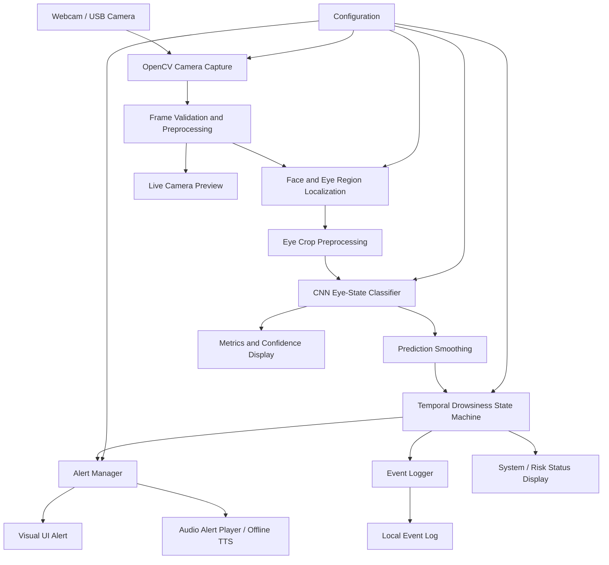
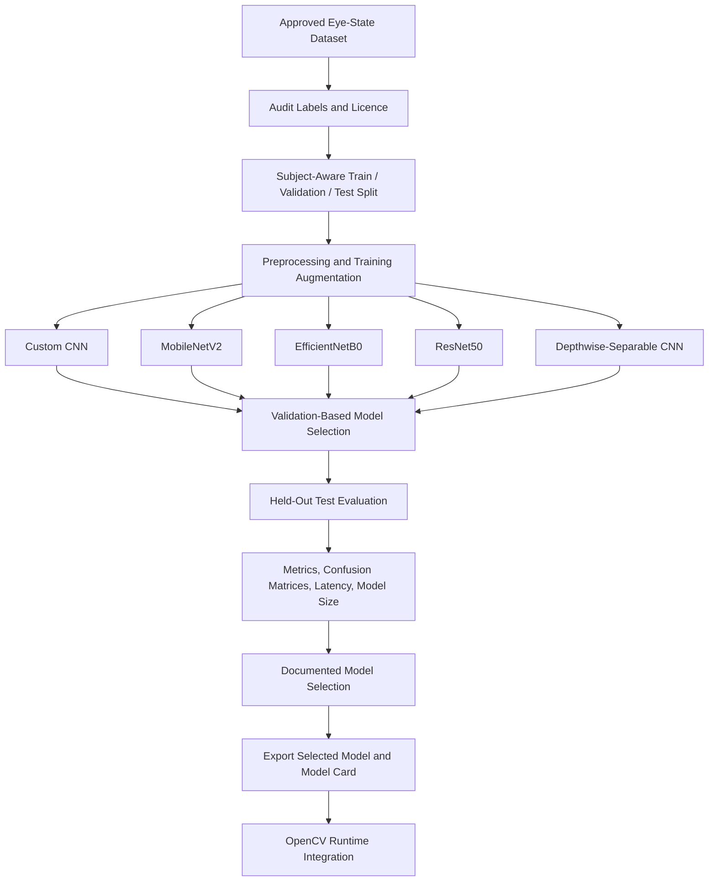

# DrishtiDrive AI — System Architecture

**Project:** DrishtiDrive AI  
**Tagline:** *A Watchful Eye on Every Journey*  
**Document:** `architecture.md`  
**Version:** 1.0  
**Last updated:** 11 October 2026  
**Primary target:** Software Edition  
**Core approach:** OpenCV + dataset-trained CNN  
**Future target:** Raspberry Pi Edge Edition

---

## 1. Purpose and Scope

This document describes the architecture for the DrishtiDrive AI Software Edition. The application captures video from a webcam, locates the driver's face and eye regions, classifies eye crops using a CNN trained on labelled open-eye and closed-eye images, interprets predictions over time, and issues staged audio and visual warnings.

The application is intended for offline-capable desktop use. The same detection pipeline may later be adapted for Raspberry Pi after performance and hardware validation.

**Safety boundary:** This is an experimental driver-assistance prototype, not a certified safety system. It cannot guarantee detection of drowsiness or diagnose fatigue. It must not control steering, braking, vehicle horns, or exterior lights. It must advise a potentially drowsy driver to stop in a safe location and rest.

## 2. Architecture Principles

1. **Local-first:** Camera processing, model inference, event decisions, and core alerts should work without internet access.
2. **Separation of concerns:** Camera capture, eye localization, classification, temporal decisions, alerts, UI, and logging are separate modules.
3. **Reproducible ML:** Dataset versions, splits, preprocessing, seeds, model checkpoints, and evaluation outputs are recorded.
4. **Measured model selection:** Compare five CNN candidates using held-out test data and safety-relevant metrics; do not assume a winner.
5. **Fail visibly:** Camera/model/audio failures must be shown clearly; uncertain detections must not be silently treated as open eyes.
6. **Privacy by default:** Do not persist camera frames or facial images by default. Store minimal event metadata.
7. **Non-invasive alerts:** Use short, clear, firm voice alerts that get the driver's attention without creating unnecessary panic.
8. **Safety-first decisions:** Use time-based logic, not a single frame, to escalate alerts. Do not claim medical validity.

---

## 3. High-Level Architecture



**Flow summary:** Camera frames are captured and validated, face/eye regions are localized, eye crops are normalized to the classifier's training input, CNN predictions are smoothed, and a time-based state machine decides whether to trigger an alert. The UI displays the live feed and current status. Event metadata is logged locally.

## 4. Runtime Components

### 4.1 Camera Capture — `camera.py`

**Responsibilities**
- Open a configured camera index or supported video source.
- Read frames using OpenCV.
- Support start/stop and release camera resources safely.
- Report camera unavailable, read failure, or disconnect states.
- Supply timestamps and frame metadata to the pipeline.

**Inputs:** Camera source and capture settings.  
**Outputs:** Frames, timestamps, camera status.

### 4.2 Frame Validation and Preprocessing

**Responsibilities**
- Check frame validity and dimensions.
- Apply any resizing or color conversion required by the detection pipeline.
- Avoid expensive processing not required for the current frame rate.
- Maintain consistent preprocessing expectations.

### 4.3 Face and Eye Localization — `eye_detection.py`

**Responsibilities**
- Find a face and eye regions using a documented detector or facial-landmark implementation.
- Return eye bounding boxes/crops and detection confidence when available.
- Handle no-face, occlusion, multiple-face, and poor-lighting cases.
- Avoid returning misleading eye crops when localization fails.

**Design note:** The CNN classifies eye crops; it does not by itself locate eyes in a full camera frame. Localization is a separate required step.

### 4.4 Eye Crop Preprocessing

**Responsibilities**
- Crop the eye region using the localization output.
- Resize to the model's required input dimensions.
- Convert color channels and normalize pixel values exactly as used in training.
- Validate shape, dtype, and value range before inference.

### 4.5 CNN Eye-State Classifier — `model_inference.py`

Train and compare five candidates:
1. Custom CNN
2. MobileNetV2
3. EfficientNetB0
4. ResNet50
5. Depthwise-separable CNN

**Responsibilities**
- Load the selected model once at application startup.
- Run inference on preprocessed eye crops.
- Return predicted class (`open`, `closed`, or `uncertain` at application level) and probabilities/confidence.
- Handle missing, incompatible, or corrupted model files with a visible error.
- Record the selected model version.

The final model must be chosen only after measured evaluation. Candidate metrics must be generated from actual runs, not filled with assumed values.

### 4.6 Prediction Smoothing

**Responsibilities**
- Reduce frame-to-frame flicker using a short rolling window or configurable smoothing rule.
- Avoid over-smoothing in a way that hides sustained closure.
- Preserve timestamps so closure duration is measured in time rather than a fixed number of frames alone.

### 4.7 Temporal Drowsiness State Machine — `drowsiness_detection.py`

**Responsibilities**
- Track sustained eye closure and repeated indicators over time.
- Use configurable thresholds validated on held-out video sequences.
- Define transitions between normal, early warning, warning, critical warning, and observation-unavailable states.
- Reset or pause timers when eye/face observations are unreliable.
- Avoid escalating from one isolated frame.
- Expose current state and reason to the UI and alert manager.

**Important:** Eye closure is a possible indicator, not definitive proof of drowsiness. Thresholds are experimental and not medically validated.

### 4.8 Alert Manager — `alert_system.py`

**Responsibilities**
- Map the state machine's state to a visual warning and an audio pattern.
- Avoid overlapping speech, duplicate bursts, and unbounded queued messages.
- Support audio testing and configurable volume.
- Keep the core alert path offline.

**Voice-alert principle:** Use short, clear, firm voice alerts that get the driver's attention without creating unnecessary panic.

| Stage | Intended condition | Example voice message |
|---|---|---|
| Stage 1 — Early warning | Repeated or unusually prolonged closure indicators | “Please stay alert. Keep your eyes on the road.” |
| Stage 2 — Warning | Sustained closure or repeated indicators | “Warning! You may be getting drowsy. Please find a safe place to stop.” |
| Stage 3 — Critical | Prolonged closure or multiple strong indicators | “Danger! Pull over safely as soon as possible. Do not continue driving while drowsy.” |

Use prerecorded audio for predictable playback, or offline text-to-speech such as `pyttsx3` with a prerecorded fallback. Optional Hindi and Marathi messages can be added after the default messages are validated. Alert sounds should be audible but not needlessly startling.

### 4.9 User Interface — `ui/`

**Layout requirements**
- Header: `DrishtiDrive AI` and `A Watchful Eye on Every Journey`.
- Large, dominant live camera feed.
- Right-side Driver Metrics and Event Log panels.
- Bottom Camera Controls and Alert System cards.
- No left navigation sidebar.
- Restrained palette: light neutral surfaces, navy/slate text, muted blue accent, and restrained green/amber/red status colors.

**Display**
- Camera/model/audio system status.
- Eye-state label and confidence.
- Closure duration and inference FPS/latency.
- Current alert stage and latest event.
- Optional landmarks/overlay toggle and camera/resolution controls.
- Any overall risk indicator must be labelled as an experimental estimate, not a validated fatigue score.

### 4.10 Event Logger — `event_logger.py`

**Responsibilities**
- Record timestamp, event type, alert stage, and relevant non-identifying measurements.
- Avoid storing facial images/video by default.
- Use bounded local log retention and handle log-write errors.
- Make logging behavior visible and configurable.

### 4.11 Configuration — `config.py`

Centralize:
- Camera source and resolution.
- Model path and input dimensions.
- Class labels and preprocessing parameters.
- Smoothing window and temporal thresholds.
- Alert cooldowns, audio volume, and message settings.
- Logging level and retention.
- UI preferences.

Avoid scattering thresholds across modules. Keep sensitive or machine-specific settings out of source control.

---

## 5. Offline Model Training and Evaluation Architecture

Training is a development workflow, not a step required every time the application launches.



### Dataset recommendations

- **Primary candidate:** MRL Eye Dataset — https://mrl.cs.vsb.cz/eyedataset
- **Alternative/supplement:** Kaggle open-eye/closed-eye datasets — https://www.kaggle.com/search?q=closed+eyes+open+eyes+dataset
- **Sequence-level evaluation:** NTHU Drowsy Driver Detection Dataset — https://cv.cs.nthu.edu.tw/php/callforpaper/datasets/DDD/

Before use, verify current access conditions, licence, labels, and permitted use. Eye-image classification datasets may not represent all driver conditions, cameras, lighting, eyewear, or head poses.

### Evaluation requirements

Report, for all five candidates:
- Test accuracy.
- Macro precision, macro recall, and macro F1.
- Per-class precision/recall and especially closed-eye recall.
- Confusion matrix and representative error analysis.
- Model file size and inference latency on the same target machine.
- Dataset split, input shape, preprocessing, seed, runtime, and dependency versions.

Avoid data leakage by splitting by subject/session where metadata permits. Tune using training/validation data; use the test split only for final comparison. Do not choose a model using accuracy alone.

---

## 6. Suggested Repository Structure

```text
DrishtiDrive-AI/
├── README.md
├── architecture.md
├── task.md
├── requirements.md
├── requirements.txt
├── .gitignore
├── configs/
│   └── default.yaml
├── dataset/
│   └── README.md
├── training/
│   ├── audit_dataset.py
│   ├── prepare_dataset.py
│   ├── train_custom_cnn.py
│   ├── train_mobilenetv2.py
│   ├── train_efficientnetb0.py
│   ├── train_resnet50.py
│   ├── train_depthwise_cnn.py
│   ├── evaluate_models.py
│   └── compare_models.py
├── models/
│   ├── README.md
│   └── selected_model.keras
├── src/
│   ├── main.py
│   ├── camera.py
│   ├── eye_detection.py
│   ├── preprocessing.py
│   ├── model_inference.py
│   ├── drowsiness_detection.py
│   ├── alert_system.py
│   ├── event_logger.py
│   ├── config.py
│   └── ui/
│       ├── main_window.py
│       ├── camera_panel.py
│       ├── metrics_panel.py
│       └── event_log_panel.py
├── tests/
│   ├── test_preprocessing.py
│   ├── test_model_inference.py
│   ├── test_state_machine.py
│   ├── test_alert_system.py
│   └── test_integration.py
├── reports/
│   ├── model_comparison.md
│   └── model_card.md
└── logs/
    └── .gitkeep
```

This is a proposed structure; adapt file names to the implementation and avoid committing downloaded datasets, private logs, or large model artifacts unless licences and repository policies allow it.

## 7. Runtime Sequence

1. Load configuration and the selected model.
2. Initialize the camera and alert subsystem.
3. Capture a frame and verify it is usable.
4. Locate the face and eye regions.
5. Preprocess eye crops using the model's training-time rules.
6. Run CNN inference and obtain class probabilities.
7. Smooth predictions and update closure-duration tracking.
8. Update the temporal state machine.
9. Display camera output, eye state, metrics, and alert status.
10. Trigger the matching alert if required.
11. Record minimal event metadata.
12. Release camera/audio resources cleanly when the user stops the application or an unrecoverable error occurs.

## 8. Error Handling and Safe Degradation

| Failure | Required behavior |
|---|---|
| Camera cannot open/disconnects | Show camera unavailable; do not claim monitoring is active |
| No face/eyes found | Show observation unavailable; do not assume eyes are open |
| Low-confidence prediction | Mark uncertain and avoid a confident classification |
| Model missing/corrupt | Display actionable error; do not silently switch to an unverified model |
| Audio output fails | Show a visible warning and retain visual alert if the UI is available |
| Event log cannot be written | Report the logging issue; monitoring should not falsely claim logging succeeded |
| Application shuts down | Stop audio, release camera, and flush/close logs safely |

## 9. Non-Functional Requirements

- **Performance:** Establish a target FPS and latency after baseline measurements; verify on target hardware.
- **Reliability:** Handle camera and audio failures without crashing the entire application where feasible.
- **Privacy:** Process locally; do not store images/video by default.
- **Maintainability:** Keep modules testable and configuration centralized.
- **Reproducibility:** Save experiment metadata and model evaluation reports.
- **Usability:** Keep status and warnings clear, readable, and consistent.
- **Safety:** No vehicle-control integration; no claims of guaranteed detection.

## 10. Verification Plan

- Unit-test preprocessing, model output mapping, state transitions, alert escalation, and cooldown behavior.
- Integration-test recorded clips and simulated camera frames.
- Test ordinary blinking versus sustained closure.
- Test glasses, lighting variation, head movement, occlusion, and camera angle changes.
- Measure false alarms and missed events on independent sequences.
- Test no-face, camera disconnect, model-load error, and audio-device failure.
- Verify offline operation and UI responsiveness during inference and speech playback.
- Never perform testing while actively driving on public roads.

## 11. Future Edge Edition

The Raspberry Pi edition reuses the conceptual pipeline but requires separate benchmarking and hardware tests. Measure FPS, latency, CPU/RAM usage, temperature, and power behavior on the actual device. Use suitable protected DC-DC power conversion for vehicle supply. Keep the initial prototype isolated from the vehicle horn, brakes, steering, and exterior-light circuits.

## 12. Definition of Architecture Complete

- [ ] Module boundaries and data flow are implemented or reflected in the codebase.
- [ ] Dataset and training workflow are reproducible.
- [ ] Five model candidates are evaluated using real results.
- [ ] Selected model is integrated into the OpenCV runtime.
- [ ] Temporal state machine and three-stage alerts are tested.
- [ ] UI and event log are integrated with privacy-safe defaults.
- [ ] Failure behavior and safety limitations are documented.
- [ ] Software Edition works offline in the intended test environment.

**Final safety note:** DrishtiDrive AI is experimental. It may miss drowsiness or raise false alarms. It does not replace adequate rest, attentive driving, or certified safety systems. A driver who feels sleepy should stop in a safe place and rest.
