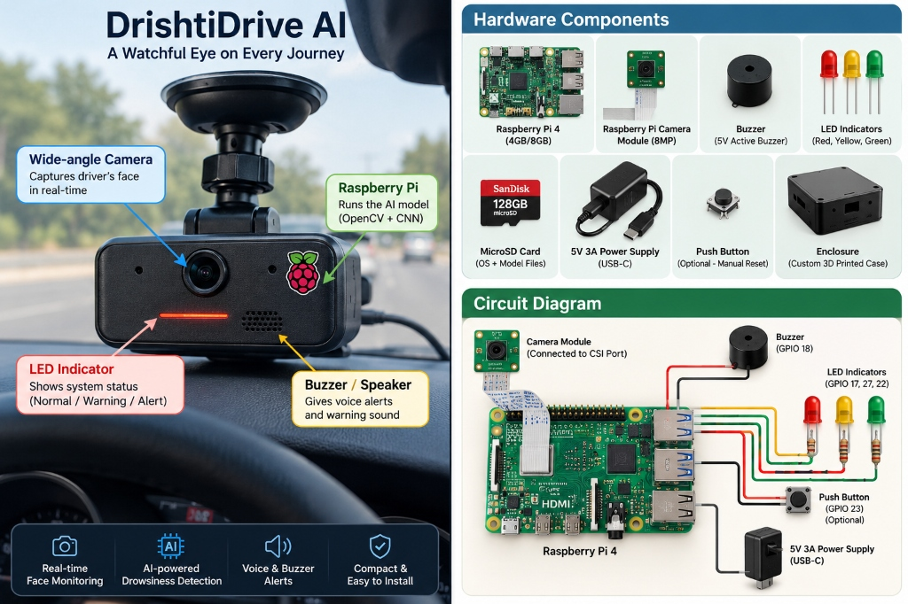

# DrishtiDrive AI — Raspberry Pi Edge Edition Architecture Notes & Hardware Blueprint

**Document:** `edge_edition_notes.md`  
**Version:** 2.0  
**Target:** Future Raspberry Pi 4B / 5 Embedded Deployment  
**Status:** Hardware Prototype Blueprint & Circuit Integration  

---

## 1. Prototype Overview & In-Cabin Enclosure

The **Raspberry Pi Edge Edition** packages DrishtiDrive AI into an autonomous, dashboard-mounted plug-and-play IoT device designed specifically for retrofit deployment in Indian commercial trucks.



### Key Enclosure & Physical Attributes:
- **Windshield Suction Mount:** High-grip suction cup adhering firmly to vertical or sloped commercial truck windshields.
- **Form Factor:** Compact dashcam-style 3D-printed enclosure (heat-resistant ABS/PETG) with forward-facing camera lens aimed at driver eye level (50–80 cm distance).
- **Driver Alert Grille:** Direct forward-facing acoustic grille for the 5V active buzzer and cabin speaker.
- **Peripheral LED Status Bar:** Tri-color LED indicators positioned on the front panel to provide ambient peripheral vision cues without blinding night vision.
- **Physical Snooze / Acknowledge Button:** Top/side-mounted tactile push button allowing the driver to acknowledge warnings without looking away from the highway.

---

## 2. Hardware Components & Bill of Materials

| Component | Specification | Quantity | Technical Role |
| :--- | :--- | :---: | :--- |
| **SBC** | Raspberry Pi 4 Model B (4GB or 8GB RAM) | 1 | Edge compute core running headless OS, OpenCV, and quantized CNN inference |
| **Camera Module** | Raspberry Pi Camera Module (8MP Wide-Angle / NoIR) | 1 | Real-time driver face and eye crop capture via MIPI CSI interface |
| **Auditory Alarm** | 5V Active Piezo Buzzer (85–90 dB) | 1 | High-intensity acoustic alerts for Stage 1 beeps and Stage 3 emergency sirens |
| **Visual Indicators** | High-Brightness Diffused LEDs (Red, Yellow, Green) | 3 | Multi-stage peripheral status indicator (Green: Normal, Yellow: Warning, Red: Alert) |
| **Reset Button** | Momentary Tactile Push Button | 1 | Manual reset and alert snooze input |
| **Storage** | 128GB SanDisk High-Endurance MicroSD Card | 1 | Root filesystem, quantized models, audio library, and rolling event logs |
| **Power Supply** | Isolated Step-Down Buck Converter (12V/24V to 5V 3A, USB-C) | 1 | Vehicle auxiliary cigarette socket power conversion |
| **Protective Shell** | Custom 3D-Printed High-Temperature Case (ABS) | 1 | Heat-resistant dashboard enclosure with passive/active cooling |

---

## 3. Circuit Schematic & GPIO Pinout Mapping

```text
 ┌─────────────────────────────────────────────────────────────────────────────┐
 │                      RASPBERRY PI 4 GPIO CIRCUIT SCHEMATIC                  │
 └─────────────────────────────────────────────────────────────────────────────┘

    [ Raspberry Pi 4 ]
    ├── MIPI CSI Port ══════════════════════════════▶ [ 8MP Camera Module ]
    ├── GPIO 18 (Pin 12) ──[ 1kΩ ]──[ NPN Transistor ]▶ [ 5V Active Buzzer ]
    ├── GPIO 17 (Pin 11) ──[ 330Ω Resistor ]────────▶ [ Red LED (Critical) ]
    ├── GPIO 27 (Pin 13) ──[ 330Ω Resistor ]────────▶ [ Yellow LED (Warning) ]
    ├── GPIO 22 (Pin 15) ──[ 330Ω Resistor ]────────▶ [ Green LED (Normal) ]
    ├── GPIO 23 (Pin 16) ──[ Pull-Up Input ]────────▶ [ Push Button (Snooze) ]
    ├── GND (Pins 6, 9, 14, 20) ────────────────────▶ Common Ground Rail
    └── USB-C Power Port ◀─────────────────────────── [ 5V 3A Buck Converter ]
                                                            ▲
                                                            │ (12V/24V Input)
                                                [ Vehicle Cigarette Socket ]
```

### Pinout Table:

| Peripheral | Raspberry Pi Pin | GPIO Reference | Wiring Specification | Functional Logic |
| :--- | :--- | :---: | :--- | :--- |
| **Camera Sensor** | Dedicated CSI Connector | *CSI-2* | 15-pin ribbon cable | Direct GPU pipeline camera input (30 FPS) |
| **5V Active Buzzer** | Physical Pin 12 | **GPIO 18** | NPN transistor (2N2222) + 1kΩ base | PWM-modulated beep / siren patterns |
| **Red Alert LED** | Physical Pin 11 | **GPIO 17** | 330Ω current-limiting resistor | HIGH during Stage 3 Critical Alarm (>3.0s closure) |
| **Yellow Warning LED** | Physical Pin 13 | **GPIO 27** | 330Ω current-limiting resistor | HIGH during Stage 1 (>0.8s) & Stage 2 (>1.8s) Warning |
| **Green Status LED** | Physical Pin 15 | **GPIO 22** | 330Ω current-limiting resistor | Solid HIGH when driver is attentive and system is active |
| **Manual Push Button** | Physical Pin 16 | **GPIO 23** | Internal pull-up to 3.3V | Active-LOW; triggers snooze and resets escalation state |
| **System Ground** | Physical Pin 6, 9, 14 | **GND** | Direct ground rail | Common ground for LEDs, buzzer, and button |
| **Power Supply** | USB-C Power Jack | **5V / 3A** | USB-C connector | Powered via automotive 12V/24V buck converter |

---

## 4. Power Supply & Electrical Isolation Rule

> [!WARNING]
> **Automotive Electrical Isolation Safety Rule (PRD §3.2):**  
> The device must be powered exclusively from the vehicle's standard auxiliary 12V/24V cigarette lighter socket via an electrically isolated step-down buck converter (12V/24V to 5V 3A, USB-C PD).  
> The device **must never** tap into the vehicle CAN bus, ECU, horn relay, steering, or brake lines.

---

## 5. Lightweight Edge Optimization

1. **Model Format Conversion:**
   - Convert PyTorch models (`depthwise_cnn_best.pt` / `mobilenetv2_best.pt`) to **TensorFlow Lite (`.tflite`)** with INT8 post-training quantization.
   - Alternatively, export to **ONNX Runtime** utilizing ARM NEON execution providers.
2. **Performance Target:**
   - Inference Latency: < 25ms per eye crop on Raspberry Pi 4 CPU.
   - Frame Rate: Stable 15–20 FPS continuous monitoring.
   - Thermal Budget: Active 5V micro-cooling fan maintaining SoC temperature < 65°C under continuous cabin heat.

---

## 6. Development Checklist & Field Deployment

- [x] Train & benchmark candidate CNN models (MobileNetV2, Depthwise CNN).
- [x] Implement 3-stage temporal debouncing state machine.
- [x] Complete Software Edition with full unit & integration tests (94 passed).
- [ ] Breadboard prototype wiring according to circuit diagram.
- [ ] Export PyTorch weights to INT8 TFLite / ONNX.
- [ ] 3D print ABS dashcam enclosure with suction mount.
- [ ] Configure headless `systemd` startup daemon (`drishtidrive.service`).
- [ ] Highway road tests under night driving and cabin noise conditions.
